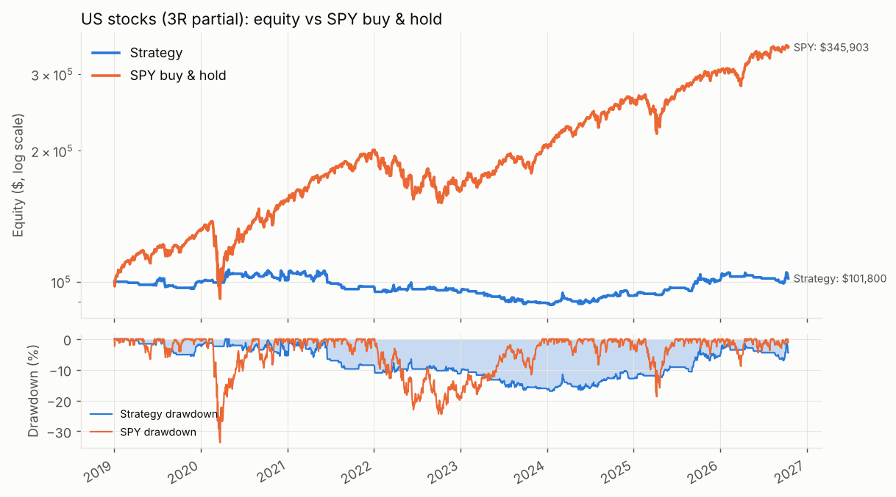
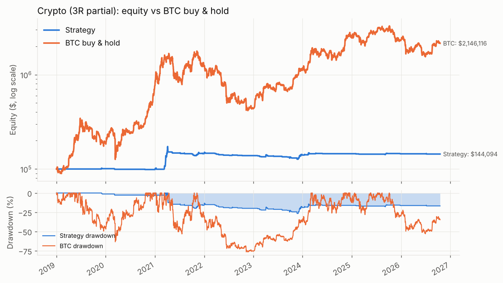
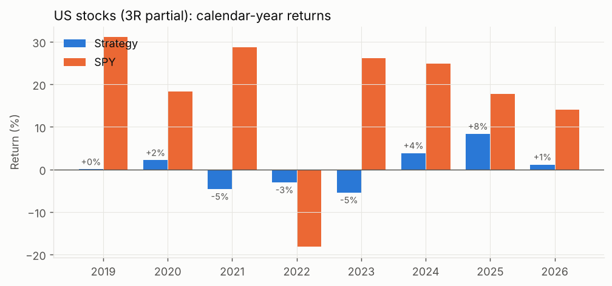

# Martin Luk momentum-pullback strategy: objective rules and daily-bar backtest

> Past performance is not indicative of future results. This study is about process and
> robustness. Its main finding is negative: translated to daily bars with a fixed 2.5–3% stop,
> the playbook does **not** reproduce anything like the discretionary track record on the
> universes tested, and the reasons are identifiable.

**Bottom line**

* **US stocks (point-in-time S&P 500, 2019-01 → 2026-10):** +0.2% CAGR, Sharpe 0.07,
  221 trades, expectancy +0.03R, 72% of trades exit on the hard stop. SPY buy & hold: +17.3% CAGR.
  No parameter in the grid gets past ~5% CAGR, and nothing beats SPY on any risk measure.
* **Crypto (Binance USDT spot, 2019-01 → 2026-10):** +4.8% CAGR, 63 trades, Sharpe 0.55 and a
  −26.6% drawdown while invested only ~1% of the time. One trade (DENT, March 2021, +102R, +$51k)
  is larger than the whole net profit (+$44k); the other 62 trades net −$7k.
  86% of crypto trades exit on the stop, half of them within one bar. BTC buy & hold: +48% CAGR.
* **Why:** the selection screen (RS leaders + resting structure + confluence zone) is slightly
  *worse* than the eligible universe over 5–20 bars in stocks and only catches up by 40 bars,
  while a 2.75% stop sits inside normal daily noise (S&P names: ATR ≈ 2%, crypto: 5–8%). Luk's
  tight stops work because the entry comes from a lower-timeframe turn a few ticks above the
  zone; a daily buy-stop above the setup bar's high cannot reproduce that.

## 1. What this is

A fully programmatic translation of the Martin Luk / @hb_stocks momentum-pullback playbook
(strong relative-strength leaders, constructive pullbacks into a support/confluence zone,
tight fixed-percentage stop, 0.5% of equity risked per trade, scale-out at 3R/5R and a 9-EMA
trail), backtested on daily bars for:

* **US stocks** – the point-in-time S&P 500 (every name that was a member on each day,
  including the ones later delisted), 2019-01-02 → 2026-10-15.
* **Crypto** – Binance USDT spot pairs: 10 majors with data to 2026-10-17 plus 208 alt pairs
  whose data ends 2024-03-13 (the universe is dynamic, so alts simply drop out after that date),
  2019-01-01 → 2026-10-17.

Everything is reproducible from this folder:

```bash
pip install -r requirements.txt
python fetch_data.py          # ~260 MB from GitHub (no API keys)
python run_all.py             # baselines + sensitivity grids -> results/
python -m pytest tests/       # primitives + engine fill logic
```

`results/SUMMARY.md` is regenerated by `run_all.py`; every table below comes from it or from
the CSVs next to it.

## 2. Rule translation (discretionary → objective)

| Playbook rule | Implementation (`luk/config.py` field) |
|---|---|
| Liquid names, price > $5, > 1M shares or > $10M/day | 20-bar average volume ≥ 1M shares **and** ≥ $10M notional (`min_adv_shares`, `min_adv_dollars`, `min_price`); crypto: ≥ $10M/day only |
| Rank by 1m/3m/6m return, top 20–30%, ≥ 30% on one horizon | Cross-sectional percentile rank of the 21/63/126-bar return among eligible names each day; composite = mean of the three ranks ≥ 0.70 and max horizon return ≥ 30% (`rs_rank_threshold`, `rs_min_return`) |
| Strong sector / theme bonus | Stocks: +0.10 to the ranking score when the stock's GICS sector ETF (XLK, XLV, …) beat SPY over 63 bars. Crypto: alts get the bonus when ETH/BTC rose over 63 bars (alt season), BTC/ETH otherwise. Only a tie-break, never a filter (`theme_weight`) |
| Skip extreme ATR / unusually low volume | ATR14/close ≤ 8% (crypto 15%), 20-bar volume ≥ 30% of its 120-bar average (`max_atr_pct`, `min_vol_ratio`) |
| Above the 9 and 21 EMA, "resting, not falling" | Close > EMA21, close ≥ EMA9 × 0.97 (a tag of the 21-EMA zone is allowed), EMA9 ≥ EMA21 × 0.97, EMA21 higher than 5 bars ago (`ema_fast_tolerance`, `ema_slope_bars`) |
| Higher lows over 3–6 weeks | Pivot lows = minimum of ±3 bars, known only 3 bars later. The last two confirmed pivot lows must be ascending, the last within 30 bars, the previous within 60, and the setup bar's low must sit above the last one (`pivot_k`, `hl_last_window`, `hl_prev_window`) |
| Volatility contraction | Mean true range over 5 bars < 0.9 × mean over 20 bars (`vcp_ratio`) |
| Reject lower highs / lower lows under falling MAs | Implied by the EMA-slope and higher-low rules; a setup bar may not itself be a fresh 10-bar high (`not_new_high_window`) |
| Confluence zone: ≥ 3 of EMA9/21/50, swing highs/lows, unfilled gaps, anchored VWAP within 1–2% | Levels: the three EMAs, the VWAP anchored at the lowest low of the trailing 120 bars (start of the advance), the last three confirmed pivot highs and lows within 60 bars, the tops of gap-ups within 90 bars that have not been filled. Largest cluster within tol = max(1.5%, 0.5 × ATR14/close) with ≥ 3 members; the setup bar's low must tag the cluster and the close must hold above its floor (`zone_tol_pct`, `zone_tol_atr`, `zone_min_levels`) |
| Prefer the first retest after a reclaim | Zero prior touches in 20 bars adds +0.10 to the score; more than 8 touching bars (a choppy range) rejects the setup (`max_prior_touches`) |
| Lower-timeframe turn / confirmation | Daily proxy: buy-stop 0.1% above the setup bar's high, filled on the next bar if the high exceeds it and the open is not more than 2% above it (`entry_mode="breakout"`). Alternative tested: buy the next open after the hold (`entry_mode="zone_open"`) |
| Stop 2.5–3% (or under the zone if tighter), 0.5% risk | Fixed 2.75% stop (`stop_pct`); `stop_mode="tighter"` tested. Shares = 0.005 × equity / (entry − stop) (`risk_pct`) |
| No averaging down, no overlapping entries | One position per name, 5-bar cooldown after an exit |
| Scale out 30–50% at 3R or 5R | 50% at 3R baseline; 5R and 30% in sensitivity (`partial_R`, `partial_frac`); stop to breakeven after the partial |
| Trail the rest with the 9 EMA | Exit the remainder at the close when it closes below EMA9, armed after the partial (optionally after +1R / +2R, `trail_activate_R`) |
| Optional extension take-profit | Sell 25% when the close is > k × ATR above EMA9 (`ext_atr_mult`, off by default; 2 and 3 tested) |
| Time-based exit | Exit if the trade has not reached +1R after 15 bars; hard cap 60 bars (`stall_bars`, `max_hold_bars`) |
| Portfolio | Max 8 concurrent names, single-name notional ≤ 30% of equity, gross exposure ≤ 100% (no margin; 150% tested), $100,000 start, compounding |
| Costs | Stocks 5 bp per side + 10 bp slippage on stop fills (0.10% round trip + slippage); crypto 10 bp per side + 20 bp on stops |

Everything at bar *t* uses only data through bar *t*; the engine acts on bar *t + 1*.

## 3. Data

| | Source | Coverage used | Notes |
|---|---|---|---|
| US stocks | [Johnbrick123/sp500-data](https://github.com/Johnbrick123/sp500-data) (release `prices.parquet` + `membership_intervals.parquet`) | 669 symbols that were S&P 500 members at some point in 2018–2026, daily OHLCV | Survivorship-bias-free: a name is tradable only while it is a member; delisted names (SIVB, TWTR, ATVI …) are included. OHLC are split- and dividend-adjusted here via `adj_close/close`; dollar volume uses the stored close × volume. Prices in the trade logs are therefore back-adjusted levels, not the tape price of the day |
| Sector map | [datasets/s-and-p-500-companies](https://github.com/datasets/s-and-p-500-companies) | current GICS sectors | Delisted names get no sector bonus |
| Crypto majors | [Speirsy11/crypto-dataset](https://github.com/Speirsy11/crypto-dataset) | BTC, ETH, SOL, BNB, XRP, TRX, DOGE, ZEC, ADA, BCH; Binance 1d candles 2017-08 → 2026-10-17 | Built from Binance 1-minute public data, UTC days |
| Crypto alts | [mdeacey/binance-crypto-coins-prices](https://github.com/mdeacey/binance-crypto-coins-prices) | 208 Binance USDT pairs after removing stablecoins, wrapped assets, leveraged tokens and dated contracts; 1d, ends 2024-03-13 | Spot prices, no funding. The alt universe therefore covers the 2020–21 bull, the 2022 bear and the 2023 recovery, but not 2024-03 onward |

Why GitHub only: this session's network policy allowed GitHub and PyPI but denied Yahoo
Finance, Binance, Kraken, Coinbase, Stooq, CoinGecko and Kaggle, so `yfinance`/`ccxt` could not
be used. `fetch_data.py` reproduces the exact inputs used here.

## 4. Results

Baseline parameters: 2.75% stop, 0.5% risk, 50% off at 3R then a 9-EMA trail, max 8 names,
no leverage, $100,000 start. Full tables and per-trade logs are in `results/`.

### 4.1 Headline metrics

| | Total | CAGR | Max DD | Sharpe | Sortino | Trades | Win rate | Avg win R | Avg loss R | Expectancy R | Profit factor | Avg bars | Avg exposure |
|---|---|---|---|---|---|---|---|---|---|---|---|---|---|
| Stocks, 3R partial (baseline) | 1.8% | 0.2% | -16.9% | 0.07 | 0.07 | 221 | 30% | 2.73 | -1.12 | 0.03 | 1.02 | 9.5 | 18% |
| Stocks, 5R partial | 13.2% | 1.6% | -20.2% | 0.24 | 0.26 | 217 | 24% | 4.08 | -1.12 | 0.13 | 1.13 | 12.0 | 23% |
| SPY buy & hold | 245.9% | 17.3% | -33.7% | 0.93 | 1.14 | 0 | n/a | n/a | n/a | n/a | n/a | n/a | 100% |

| | Total | CAGR | Max DD | Sharpe | Sortino | Trades | Win rate | Avg win R | Avg loss R | Expectancy R | Profit factor | Avg bars | Avg exposure |
|---|---|---|---|---|---|---|---|---|---|---|---|---|---|
| Crypto, 3R partial (baseline) | 44.1% | 4.8% | -26.6% | 0.55 | 0.30 | 63 | 27% | 10.07 | -1.67 | 1.50 | 1.83 | 3.9 | 1% |
| Crypto, 5R partial | 50.1% | 5.3% | -24.0% | 0.60 | 0.33 | 63 | 22% | 13.04 | -1.63 | 1.63 | 1.89 | 4.2 | 1% |
| BTC buy & hold | 2046.1% | 48.2% | -76.6% | 0.95 | 1.29 | 0 | n/a | n/a | n/a | n/a | n/a | n/a | 100% |
*Sharpe/Sortino use daily returns annualised with 252 (stocks) or 365 (crypto) bars. "Avg exposure"
is gross notional / equity averaged over all days; the strategies are mostly in cash.*




### 4.2 Year by year (3R baseline)

| Year | Strategy | SPY | Trades | Win rate | Avg R |
|---|---|---|---|---|---|
| 2019 | +0.0% | +31.1% | 15 | 27% | -0.43 |
| 2020 | +2.2% | +18.4% | 42 | 33% | +0.21 |
| 2021 | -4.6% | +28.7% | 38 | 24% | -0.17 |
| 2022 | -3.0% | -18.2% | 27 | 26% | -0.22 |
| 2023 | -5.4% | +26.2% | 24 | 21% | -0.46 |
| 2024 | +3.9% | +24.9% | 33 | 33% | +0.23 |
| 2025 | +8.4% | +17.7% | 23 | 39% | +0.68 |
| 2026 | +1.2% | +14.1% | 19 | 37% | +0.17 |

| Year | Strategy | BTC | Trades | Win rate | Avg R |
|---|---|---|---|---|---|
| 2019 | +0.8% | +89.5% | 1 | 100% | +1.64 |
| 2020 | -2.0% | +302.0% | 2 | 0% | -2.05 |
| 2021 | +47.2% | +59.8% | 19 | 21% | +5.12 |
| 2022 | -4.7% | -64.2% | 11 | 18% | -0.86 |
| 2023 | +1.3% | +155.6% | 18 | 28% | +0.22 |
| 2024 | +3.5% | +121.3% | 6 | 67% | +1.15 |
| 2025 | -0.3% | -6.3% | 5 | 20% | -0.10 |
| 2026 | -0.6% | -7.0% | 1 | 0% | -1.14 |


The crypto alt universe ends 2024-03-13; from then on only the 10 majors are tradable, which
is why 2024–2026 show only 1–6 trades a year.

### 4.3 Regime split (benchmark above/below its 200-day SMA)

| Market | Regime | Share of days | Strategy (annualised) | Benchmark (annualised) |
|---|---|---|---|---|
| Stocks | SPY above 200-SMA (uptrend) | 82% | −0.5% | +29.7% |
| Stocks | SPY below 200-SMA (down/sideways) | 18% | +3.5% | −24.9% |
| Crypto | BTC above 200-SMA | 58% | +7.4% | +129% |
| Crypto | BTC below 200-SMA | 42% | −2.1% | −39% |

In stocks the strategy made its small profit in the *down* regime (2022, where it was flat while
SPY fell 18%) and lost money in the strong uptrends of 2021 and 2023, the exact years a
momentum-leader strategy should shine. Capital preservation works; the offence does not.

### 4.4 Where the trades end (3R baseline)

| Exit | Stocks: n | Stocks: avg R | Crypto: n | Crypto: avg R |
|---|---|---|---|---|
| Hard stop (intraday) | 127 | −1.03 | 35 | −0.49 (includes breakeven stops after a partial) |
| Stop gapped through at the open | 32 | −1.17 | 19 | −2.41 |
| 9-EMA trail (after the 3R partial) | 57 | +3.03 | 9 | +17.49 |
| Stall / time | 5 | +0.29 | 0 | – |

Every winning trade is a partial-plus-trail; everything else is a −1R. The payoff profile is
30% win rate × 2.7R average win in stocks, which is break-even after costs. The average
crypto loss of −1.67R (not −1R) is the gap-through: alt coins routinely open far below the
stop.

### 4.5 Signal quality: is the screen picking good names?

Forward close-to-close return after a triggered entry versus every eligible name on the same
days (`results/*/signal_quality.csv`):

| Horizon | Stocks: signal mean / hit rate | Stocks: universe mean / hit rate | Crypto: signal | Crypto: universe |
|---|---|---|---|---|
| 5 bars | +0.1% / 53% | +0.3% / 54% | −1.1% / 40% | +0.8% / 48% |
| 10 bars | +0.3% / 54% | +0.5% / 55% | +2.2% / 44% | +1.5% / 47% |
| 20 bars | +0.9% / 52% | +1.1% / 56% | +3.6% / 40% | +3.1% / 45% |
| 40 bars | +3.6% / 57% | +2.2% / 57% | +5.8% / 43% | +5.9% / 43% |

The setups are not better than the universe over the horizon the exits operate on (5–20 bars).
Whatever edge exists shows up only at 40 bars, far beyond the 5-bar median hold. This is the
most important diagnostic in the study: tweaking exits cannot fix a screen with no short-term
edge, and the sensitivity grid confirms it.

### 4.6 Sensitivity (one parameter at a time; full table in `results/SUMMARY.md`)

Stocks (CAGR / max DD / Sharpe / expectancy R):

| Parameter | Values | Result |
|---|---|---|
| Stop distance | 2% → 4% | −1.6% → +0.6% CAGR; best in-range 3–3.5% (+1.3%, Sharpe 0.23). Extending beyond the spec: 6% +1.4%, 8% +2.4% (Sharpe 0.52, DD −7.5%, win rate 45%). Wider stops lift the win rate from 28% to 45% but shrink R, so expectancy stays ≤ 0.18R |
| Risk per trade | 0.25% → 1% | CAGR 0.0% → 0.9%; drawdown −11% → −28%. Pure leverage on a ~zero edge |
| Partial level | 3R vs 5R | 5R better (+1.6% vs +0.2%; 0.13R vs 0.03R) because the few winners run; win rate drops to 24% |
| Partial size | 30% vs 50% | 50% slightly better; immaterial |
| RS rank threshold | 0.5 → 0.8 | 0.6 best (+1.4%); 0.8 negative. No monotone relationship = no robust edge in the ranking cut-off |
| Min horizon return | 20% → 40% | 20% negative (346 trades), 30–40% ≈ 0 |
| Trail arming | after partial / +1R / +2R | Arming early (+1R) hurts (−1.0%): the trail exits before the 3R partial can happen |
| Entry mode | breakout vs buy-the-open after the hold | Open entry: +1.2% CAGR, 316 trades, 0.07R. Closer-to-zone entry helps a little, not enough |
| Stop mode | fixed vs tighter-of(fixed, zone low) | Tighter is worse (−1.0%) |
| Extension sell | off / 2 ATR / 3 ATR | Immaterial |
| Max positions / leverage | 5–10 / 1.0–1.5× | Immaterial: the strategy never fills more than a few slots |
| Zone tolerance | 1% / 1.5% / 2% | 1.5% best, both neighbours negative: fragile |
| Zone min levels | 2 / 3 / 4 | 4 gives the best per-trade stats (0.16R, PF 1.21) but only 57 trades |
| First-retest filter | ≤3 / ≤8 / ≤20 touches | ≤3 (the strict reading) gives 52 trades; no effect on expectancy |
| Volatility contraction | 0.9 / off | Off adds trades (328) at the same expectancy |

Crypto: stop 2–4% gives CAGR 4.9–6.2% with the same 63 trades (the stop only changes how
much each loser costs); 5R partial and 30% partial size are marginally better; `zone_open`
entries turn the result negative (−1.0%); `rs_rank_threshold` 0.8 leaves 36 trades. Every
crypto number is hostage to the DENT trade and should be read as "no evidence", not as
"+5% a year".

### 4.7 Grid: stop × partial × risk (`results/*/grid_stop_partial_risk.csv`)

Stocks, best cells: 3.5% stop / 5R / 1% risk → +5.1% CAGR, Sharpe 0.45, DD −33%; 3% / 5R / 1% →
+4.6%, Sharpe 0.44, DD −28%. The 2% stop is negative in every cell. Nothing approaches SPY
(+17.3%, Sharpe 0.93) and the best cells are the highest-leverage ones, which is what a flat
edge looks like under a grid search.

### 4.8 Strongest parameter combinations (and why they should not be trusted)

* Stocks: stop 3–3.5%, 5R partial, trail only after the partial, RS threshold 0.6, open entry
  after the hold. Combined these would land in the +3–5% CAGR range with 25–35% drawdowns.
  That is in-sample selection over ~220 trades; adjacent values (2.5% stop, 2% zone tolerance,
  0.8 RS threshold) flip the sign, which is the signature of noise, not of an edge.
* Crypto: wider stops (3.5–4%) with the 5R partial are the only cells where the drawdown falls
  below −20%, because losers stop being gap-throughs. Still one-trade dependent.

## 5. Failure modes observed

1. **Stops inside daily noise.** 72% (stocks) and 86% (crypto) of trades end at the hard stop;
   the median crypto hold is one bar. A 2.75% stop is ~1.3 daily ATRs for an S&P name and
   ~0.4 ATRs for an alt coin.
2. **Chop.** The worst stock years (2021, 2023) were sideways-with-rotation markets for
   leaders: the structure filter kept finding "resting" names that were in fact topping, and the
   screen's 5–20-bar forward return never beat the universe.
3. **Signal correlation.** Setups cluster in time (post-crash rebounds in April–June 2020,
   early 2021 for crypto) so the 8 slots fill with correlated names and a single market dip stops
   them all out together: 42 stock trades in 2020 and 19 crypto trades in 2021 happened in
   bursts.
4. **Fat-tail dependence.** The crypto P&L is one DENT trade. Removing it, the crypto leg loses
   money. A strategy whose result depends on one parabolic alt is not a strategy.
5. **Gap-throughs.** Crypto losers average −1.67R because alts open through the stop; the
   fixed-% stop assumption understates the real risk per trade.
6. **Universe.** In the S&P 500 "up ≥ 30% in 1–6 months" leaves ~600 setup-days in eight years;
   Luk's leaders are mostly mid/small caps and recent IPOs, which this dataset does not contain.
7. **Under-deployment.** Average exposure 18% (stocks) and 1% (crypto). With 0.5% risk and a
   2.75% stop each position is ~18% of equity, so even a full book is only 5–6 names and the
   no-margin cap binds. The compounding Luk achieved requires both a much higher hit rate and
   far more frequent deployment than daily bars provide.

## 6. Approximations and limitations

* **Daily bars.** Every lower-timeframe element of the playbook (the 5–15-minute turn, intraday
  stops under the zone, same-day re-entries) is replaced by a next-bar buy-stop above the setup
  bar's high. Stops fill at the stop price (or the open on gaps) plus 10–20 bp slippage; partials
  fill at the limit price (or the open if it gaps above). The 9-EMA trail exits at the signal
  bar's close, which assumes a market-on-close order placed in the final minutes.
* **Theme detection** is a proxy: sector-ETF relative strength from a *current* constituent
  file (delisted names get no bonus) in stocks, ETH/BTC momentum in crypto. It is only a
  ranking tie-break.
* **Anchored VWAP** anchors at the lowest low of the trailing 120 bars rather than a
  hand-picked base start. Unfilled gaps are gap-ups within 90 bars whose bottom has not been
  traded back into.
* **Pivot confirmation** uses ±3 bars; a pivot is used only after it is known, which delays
  the higher-low test by three bars relative to what a discretionary trader would see.
* **Price filter** (> $5) is applied to split-adjusted prices, so a name that later split 10:1
  can be excluded in early years.
* **Survivorship:** none in stocks (point-in-time membership, delisted names priced to their
  last trade). The crypto alt list is the set of pairs that existed on Binance as of March 2024,
  so pairs delisted before then are missing (a mild survivorship bias in favour of the strategy).
* **Data quality:** stock OHLCV from Yahoo (via the dataset's own CRSP cross-check), delisted
  names from Tiingo; two carried no-trade days and ~39k close-only rows were dropped. Crypto
  spot prices with no funding, no borrow, no exchange outages modelled.
* **Look-ahead:** cross-sectional ranks, EMAs, pivots and zones at bar *t* use data through
  bar *t*; the engine trades bar *t + 1*. Membership is point-in-time. The sector file is the
  one piece of present-day information used (as a tie-break only).
* **Regime dependence:** eight years including the 2020 crash, the 2021 melt-up, the 2022 bear
  and the 2023–2025 bull. The strategy did not have a good year in any of them in stocks.
* **No walk-forward optimisation** was run on purpose: the full-period edge is ≈ 0, so there is
  nothing to validate out of sample. The year-by-year and regime tables serve as the
  out-of-sample view.

## 7. What would be needed to test the playbook faithfully

1. Intraday (5-minute) bars for entries and stops, so the stop can sit just under the zone
   with a realistic R.
2. A broad universe (all US listings > $10M/day, including recent IPOs and small caps) with
   point-in-time listings.
3. A theme model built from co-movement clusters rather than a static sector file.
4. Separate accounting for the "first retest after reclaim" pattern on the 65-minute chart,
   which the daily proxy cannot express.

## 8. Files

```
research/luk_momentum_pullback/
├── README.md              this document
├── fetch_data.py          downloads the datasets into data/ (gitignored)
├── run_all.py             baselines, benchmarks, yearly/regime tables, sensitivity + grid
├── requirements.txt
├── luk/
│   ├── config.py          Params dataclass: every rule as a field
│   ├── data.py            loaders -> wide OHLCV frames + point-in-time universe masks
│   ├── features.py        EMAs/ATR, RS ranks, pivots, higher lows, VCP, AVWAP, gaps, zones, setups
│   ├── engine.py          event-driven daily portfolio simulation (stops, partials, trail, sizing)
│   ├── metrics.py         summary stats, yearly & regime tables
│   └── report.py          charts and markdown tables
├── tests/test_core.py     primitives + engine fill logic
└── results/
    ├── SUMMARY.md         auto-generated: all tables for both markets
    ├── run_log.txt
    ├── stocks/, crypto/   *_equity.csv/.png, *_trades.csv, *_yearly.csv, *_regime.csv,
    │                      *_summary.json, sensitivity.csv, grid_stop_partial_risk.csv,
    │                      signal_quality.csv
```
