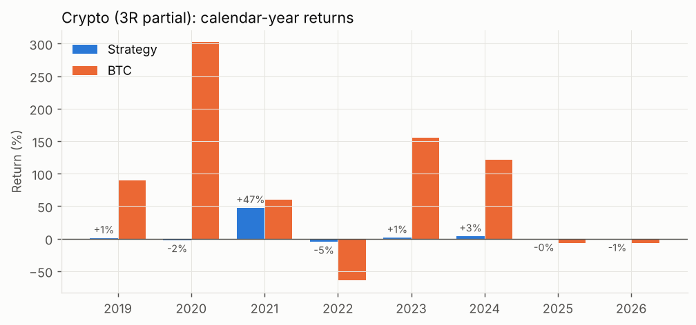

# Results summary (auto-generated by run_all.py)

## US stocks

Data notes: dropped 2 no-trade (carried) rows; dropped 39022 rows lacking OHLCV; 669 symbols, 2209 bars, 2018-01-02 -> 2026-10-15

Feature funnel: `{'bars': 2209, 'symbols': 669, 'eligible_symbol_days': 838740, 'structure_days': 73828, 'setups': 8056, 'rs_pass_setups': 596}`

### Headline metrics

| Metric | Strategy 3R partial | Strategy 5R partial | SPY buy & hold |
|---|---|---|---|
| Total return | 1.8% | 13.2% | 245.9% |
| CAGR | 0.2% | 1.6% | 17.3% |
| Max drawdown | -16.9% | -20.2% | -33.7% |
| Sharpe | 0.07 | 0.24 | 0.93 |
| Sortino | 0.07 | 0.26 | 1.14 |
| Ann. vol | 6.6% | 8.1% | 19.2% |
| Trades | 221 | 217 | 0 |
| Win rate | 29.9% | 24.0% | n/a |
| Avg win (R) | 2.73 | 4.08 | n/a |
| Avg loss (R) | -1.12 | -1.12 | n/a |
| Expectancy (R) | 0.03 | 0.13 | n/a |
| Profit factor | 1.02 | 1.13 | n/a |
| Avg bars held | 9.5 | 12.0 | n/a |
| Avg gross exposure | 17.5% | 23.0% | 100.0% |
| Days with a position | 52.0% | 60.5% | 100.0% |

### Year by year (3R baseline)

| year | strategy | strategy_max_dd_in_year | benchmark | trades | win_rate | avg_R |
|---|---|---|---|---|---|---|
| 2019 | 0.0% | -5.6% | 31.1% | 15 | 26.7% | -0.43 |
| 2020 | 2.2% | -5.6% | 18.4% | 42 | 33.3% | 0.21 |
| 2021 | -4.6% | -9.3% | 28.7% | 38 | 23.7% | -0.17 |
| 2022 | -3.0% | -5.1% | -18.2% | 27 | 25.9% | -0.22 |
| 2023 | -5.4% | -7.7% | 26.2% | 24 | 20.8% | -0.46 |
| 2024 | 3.9% | -5.9% | 24.9% | 33 | 33.3% | 0.23 |
| 2025 | 8.4% | -4.8% | 17.7% | 23 | 39.1% | 0.68 |
| 2026 | 1.2% | -5.6% | 14.1% | 19 | 36.8% | 0.17 |

### Regime split (3R baseline)

| regime | days | pct_of_days | strategy_total | strategy_ann | benchmark_total | benchmark_ann |
|---|---|---|---|---|---|---|
| benchmark above 200-SMA (uptrend) | 1598 | 81.6% | -3.1% | -0.5% | 420.6% | 29.7% |
| benchmark below 200-SMA (down/sideways) | 360 | 18.4% | 5.1% | 3.5% | -33.6% | -24.9% |

### Exit reasons (3R baseline)

| exit_reason | n | avg_R | win_rate |
|---|---|---|---|
| ema_trail | 57 | 3.03 | 100.0% |
| stall | 5 | 0.29 | 80.0% |
| stop | 127 | -1.03 | 1.6% |
| stop_gap | 32 | -1.17 | 9.4% |

### Signal quality: forward returns after a triggered entry vs. the eligible universe

| horizon_bars | n_signals | signal_mean | signal_median | signal_hit_rate | universe_mean | universe_hit_rate |
|---|---|---|---|---|---|---|
| 5 | 304 | 0.1% | 0.3% | 53.0% | 0.3% | 54.0% |
| 10 | 300 | 0.3% | 0.6% | 54.0% | 0.5% | 55.0% |
| 20 | 298 | 0.9% | 0.4% | 52.0% | 1.1% | 55.9% |
| 40 | 294 | 3.6% | 2.9% | 56.8% | 2.2% | 57.4% |

### Sensitivity (one parameter at a time, others at baseline)

| axis | value | n_trades | cagr | max_drawdown | sharpe | win_rate | expectancy_R | profit_factor | exposure_avg |
|---|---|---|---|---|---|---|---|---|---|
| stop_pct | 0.02 | 225 | -1.6% | -23.5% | -0.21 | 27.6% | -0.10 | 0.87 | 15.2% |
| stop_pct | 0.025 | 220 | -0.0% | -18.2% | 0.03 | 29.1% | 0.01 | 1.00 | 17.1% |
| stop_pct | 0.0275 | 221 | 0.2% | -16.9% | 0.07 | 29.9% | 0.03 | 1.02 | 17.5% |
| stop_pct | 0.03 | 225 | 1.3% | -16.4% | 0.23 | 31.1% | 0.10 | 1.12 | 18.3% |
| stop_pct | 0.035 | 228 | 1.1% | -13.3% | 0.20 | 31.1% | 0.09 | 1.10 | 19.3% |
| stop_pct | 0.04 | 224 | 0.6% | -18.2% | 0.13 | 30.8% | 0.06 | 1.06 | 19.4% |
| stop_pct | 0.06 | 222 | 1.4% | -15.7% | 0.28 | 39.2% | 0.11 | 1.17 | 16.1% |
| stop_pct | 0.08 | 217 | 2.4% | -7.5% | 0.52 | 45.2% | 0.18 | 1.40 | 13.6% |
| risk_pct | 0.0025 | 235 | -0.0% | -11.1% | 0.01 | 29.4% | 0.00 | 0.99 | 9.3% |
| risk_pct | 0.005 | 221 | 0.2% | -16.9% | 0.07 | 29.9% | 0.03 | 1.02 | 17.5% |
| risk_pct | 0.0075 | 209 | 0.8% | -22.8% | 0.13 | 30.6% | 0.05 | 1.05 | 23.8% |
| risk_pct | 0.01 | 198 | 0.9% | -27.6% | 0.14 | 30.8% | 0.05 | 1.06 | 24.8% |
| partial_R | 3.0 | 221 | 0.2% | -16.9% | 0.07 | 29.9% | 0.03 | 1.02 | 17.5% |
| partial_R | 5.0 | 217 | 1.6% | -20.2% | 0.24 | 24.0% | 0.13 | 1.13 | 23.0% |
| partial_frac | 0.3 | 221 | -0.2% | -18.3% | 0.01 | 29.4% | 0.00 | 0.99 | 18.5% |
| partial_frac | 0.5 | 221 | 0.2% | -16.9% | 0.07 | 29.9% | 0.03 | 1.02 | 17.5% |
| rs_rank_threshold | 0.5 | 295 | 0.3% | -23.6% | 0.08 | 29.8% | 0.03 | 1.02 | 21.6% |
| rs_rank_threshold | 0.6 | 273 | 1.4% | -23.2% | 0.23 | 31.5% | 0.09 | 1.10 | 20.9% |
| rs_rank_threshold | 0.7 | 221 | 0.2% | -16.9% | 0.07 | 29.9% | 0.03 | 1.02 | 17.5% |
| rs_rank_threshold | 0.8 | 152 | -0.6% | -22.3% | -0.09 | 27.6% | -0.05 | 0.92 | 10.6% |
| rs_min_return | 0.2 | 346 | -1.0% | -16.7% | -0.08 | 28.9% | -0.03 | 0.95 | 31.6% |
| rs_min_return | 0.3 | 221 | 0.2% | -16.9% | 0.07 | 29.9% | 0.03 | 1.02 | 17.5% |
| rs_min_return | 0.4 | 134 | 0.2% | -11.1% | 0.07 | 30.6% | 0.04 | 1.03 | 9.2% |
| max_positions | 5 | 218 | 0.1% | -17.0% | 0.05 | 29.8% | 0.02 | 1.01 | 17.3% |
| max_positions | 8 | 221 | 0.2% | -16.9% | 0.07 | 29.9% | 0.03 | 1.02 | 17.5% |
| max_positions | 10 | 221 | 0.2% | -16.9% | 0.07 | 29.9% | 0.03 | 1.02 | 17.5% |
| max_gross_exposure | 1.0 | 221 | 0.2% | -16.9% | 0.07 | 29.9% | 0.03 | 1.02 | 17.5% |
| max_gross_exposure | 1.5 | 223 | 0.2% | -16.9% | 0.06 | 29.6% | 0.03 | 1.02 | 17.5% |
| trail_activate_R | 0.0 | 221 | 0.2% | -16.9% | 0.07 | 29.9% | 0.03 | 1.02 | 17.5% |
| trail_activate_R | 1.0 | 226 | -1.0% | -19.5% | -0.15 | 37.2% | -0.06 | 0.90 | 12.8% |
| trail_activate_R | 2.0 | 222 | -0.5% | -18.1% | -0.05 | 33.3% | -0.03 | 0.95 | 14.8% |
| entry_mode | breakout | 221 | 0.2% | -16.9% | 0.07 | 29.9% | 0.03 | 1.02 | 17.5% |
| entry_mode | zone_open | 316 | 1.2% | -16.0% | 0.19 | 30.7% | 0.07 | 1.08 | 26.9% |
| stall_bars | 10 | 221 | -0.2% | -18.8% | -0.00 | 29.4% | -0.00 | 0.98 | 16.4% |
| stall_bars | 15 | 221 | 0.2% | -16.9% | 0.07 | 29.9% | 0.03 | 1.02 | 17.5% |
| stall_bars | 25 | 221 | 0.4% | -16.7% | 0.10 | 29.4% | 0.04 | 1.04 | 18.6% |
| max_hold_bars | 20 | 225 | 0.3% | -17.0% | 0.08 | 31.6% | 0.03 | 1.03 | 14.7% |
| max_hold_bars | 60 | 221 | 0.2% | -16.9% | 0.07 | 29.9% | 0.03 | 1.02 | 17.5% |
| max_hold_bars | 120 | 221 | 0.2% | -16.9% | 0.07 | 29.9% | 0.03 | 1.02 | 17.5% |
| ext_atr_mult | 0.0 | 221 | 0.2% | -16.9% | 0.07 | 29.9% | 0.03 | 1.02 | 17.5% |
| ext_atr_mult | 2.0 | 222 | 0.5% | -15.9% | 0.12 | 30.2% | 0.05 | 1.05 | 17.0% |
| ext_atr_mult | 3.0 | 221 | 0.2% | -16.9% | 0.07 | 29.9% | 0.03 | 1.02 | 17.5% |
| stop_mode | fixed | 221 | 0.2% | -16.9% | 0.07 | 29.9% | 0.03 | 1.02 | 17.5% |
| stop_mode | tighter | 227 | -1.0% | -19.9% | -0.12 | 28.2% | -0.06 | 0.91 | 16.6% |
| vcp_ratio | 0.9 | 221 | 0.2% | -16.9% | 0.07 | 29.9% | 0.03 | 1.02 | 17.5% |
| vcp_ratio | 1.0 | 328 | 0.5% | -23.3% | 0.10 | 30.5% | 0.03 | 1.03 | 24.6% |
| max_prior_touches | 3 | 52 | 0.2% | -8.0% | 0.07 | 25.0% | 0.06 | 1.06 | 4.3% |
| max_prior_touches | 8 | 221 | 0.2% | -16.9% | 0.07 | 29.9% | 0.03 | 1.02 | 17.5% |
| max_prior_touches | 20 | 349 | -0.2% | -20.6% | 0.02 | 29.8% | 0.00 | 0.99 | 30.2% |
| zone_tol_pct | 0.01 | 219 | -1.5% | -19.6% | -0.22 | 26.9% | -0.10 | 0.87 | 14.9% |
| zone_tol_pct | 0.015 | 221 | 0.2% | -16.9% | 0.07 | 29.9% | 0.03 | 1.02 | 17.5% |
| zone_tol_pct | 0.02 | 225 | -1.3% | -22.6% | -0.18 | 25.3% | -0.08 | 0.89 | 16.5% |
| zone_min_levels | 2 | 306 | -0.6% | -24.2% | -0.04 | 28.8% | -0.02 | 0.96 | 23.4% |
| zone_min_levels | 3 | 221 | 0.2% | -16.9% | 0.07 | 29.9% | 0.03 | 1.02 | 17.5% |
| zone_min_levels | 4 | 57 | 0.6% | -8.5% | 0.18 | 33.3% | 0.16 | 1.21 | 4.6% |

### Grid: stop x partial level x risk per trade

| stop_pct | partial_R | risk_pct | n_trades | cagr | max_drawdown | sharpe | expectancy_R | profit_factor |
|---|---|---|---|---|---|---|---|---|
| 0.02 | 3.00 | 0.00 | 239 | -1.0% | -15.1% | -0.24 | -0.12 | 0.86 |
| 0.02 | 3.00 | 0.01 | 225 | -1.6% | -23.5% | -0.21 | -0.10 | 0.87 |
| 0.02 | 3.00 | 0.01 | 203 | -0.8% | -25.5% | -0.07 | -0.02 | 0.94 |
| 0.02 | 5.00 | 0.00 | 236 | -0.0% | -13.4% | 0.01 | 0.00 | 0.99 |
| 0.02 | 5.00 | 0.01 | 214 | 0.8% | -17.8% | 0.13 | 0.07 | 1.06 |
| 0.02 | 5.00 | 0.01 | 194 | 1.1% | -24.3% | 0.17 | 0.06 | 1.08 |
| 0.025 | 3.00 | 0.00 | 236 | -0.3% | -12.2% | -0.08 | -0.04 | 0.94 |
| 0.025 | 3.00 | 0.01 | 220 | -0.0% | -18.2% | 0.03 | 0.01 | 1.00 |
| 0.025 | 3.00 | 0.01 | 201 | -0.2% | -29.1% | 0.01 | 0.00 | 0.98 |
| 0.025 | 5.00 | 0.00 | 231 | 0.3% | -11.6% | 0.08 | 0.04 | 1.04 |
| 0.025 | 5.00 | 0.01 | 216 | 0.5% | -20.1% | 0.10 | 0.05 | 1.04 |
| 0.025 | 5.00 | 0.01 | 183 | 2.5% | -25.0% | 0.30 | 0.12 | 1.16 |
| 0.03 | 3.00 | 0.00 | 232 | 0.6% | -8.9% | 0.19 | 0.09 | 1.11 |
| 0.03 | 3.00 | 0.01 | 225 | 1.3% | -16.4% | 0.23 | 0.10 | 1.12 |
| 0.03 | 3.00 | 0.01 | 192 | 2.2% | -23.5% | 0.27 | 0.11 | 1.14 |
| 0.03 | 5.00 | 0.00 | 228 | 1.2% | -12.0% | 0.30 | 0.17 | 1.19 |
| 0.03 | 5.00 | 0.01 | 221 | 2.4% | -22.3% | 0.33 | 0.19 | 1.20 |
| 0.03 | 5.00 | 0.01 | 175 | 4.6% | -27.8% | 0.44 | 0.23 | 1.28 |
| 0.035 | 3.00 | 0.00 | 230 | 0.6% | -7.1% | 0.18 | 0.08 | 1.10 |
| 0.035 | 3.00 | 0.01 | 228 | 1.1% | -13.3% | 0.20 | 0.09 | 1.10 |
| 0.035 | 3.00 | 0.01 | 185 | 3.3% | -19.7% | 0.35 | 0.16 | 1.20 |
| 0.035 | 5.00 | 0.00 | 226 | 1.5% | -11.9% | 0.37 | 0.22 | 1.26 |
| 0.035 | 5.00 | 0.01 | 221 | 2.9% | -21.9% | 0.39 | 0.23 | 1.25 |
| 0.035 | 5.00 | 0.01 | 170 | 5.1% | -33.1% | 0.45 | 0.27 | 1.29 |
| 0.04 | 3.00 | 0.00 | 224 | 0.3% | -9.5% | 0.12 | 0.05 | 1.06 |
| 0.04 | 3.00 | 0.01 | 224 | 0.6% | -18.2% | 0.13 | 0.06 | 1.06 |
| 0.04 | 3.00 | 0.01 | 190 | 1.5% | -25.7% | 0.19 | 0.08 | 1.08 |
| 0.04 | 5.00 | 0.00 | 223 | 0.8% | -11.9% | 0.21 | 0.12 | 1.14 |
| 0.04 | 5.00 | 0.01 | 223 | 1.4% | -22.6% | 0.21 | 0.12 | 1.12 |
| 0.04 | 5.00 | 0.01 | 182 | 1.9% | -33.1% | 0.21 | 0.11 | 1.10 |

## Crypto

Data notes: 10 Binance majors from Speirsy11/crypto-dataset (2017-08-17 -> 2026-10-17); 208 Binance alt pairs from mdeacey/binance-crypto-coins-prices (daily, ends 2024-03-13); 218 symbols, 3212 bars, 2018-01-01 -> 2026-10-17

Feature funnel: `{'bars': 3212, 'symbols': 218, 'eligible_symbol_days': 87924, 'structure_days': 6705, 'setups': 959, 'rs_pass_setups': 157}`

### Headline metrics

| Metric | Strategy 3R partial | Strategy 5R partial | BTC buy & hold |
|---|---|---|---|
| Total return | 44.1% | 50.1% | 2,046.1% |
| CAGR | 4.8% | 5.3% | 48.2% |
| Max drawdown | -26.6% | -24.0% | -76.6% |
| Sharpe | 0.55 | 0.60 | 0.95 |
| Sortino | 0.30 | 0.33 | 1.29 |
| Ann. vol | 9.3% | 9.4% | 61.2% |
| Trades | 63 | 63 | 0 |
| Win rate | 27.0% | 22.2% | n/a |
| Avg win (R) | 10.07 | 13.04 | n/a |
| Avg loss (R) | -1.67 | -1.63 | n/a |
| Expectancy (R) | 1.50 | 1.63 | n/a |
| Profit factor | 1.83 | 1.89 | n/a |
| Avg bars held | 3.9 | 4.2 | n/a |
| Avg gross exposure | 1.3% | 1.5% | 100.0% |
| Days with a position | 7.3% | 7.8% | 100.0% |

### Year by year (3R baseline)

| year | strategy | strategy_max_dd_in_year | benchmark | trades | win_rate | avg_R |
|---|---|---|---|---|---|---|
| 2019 | 0.8% | -1.3% | 89.5% | 1 | 100.0% | 1.64 |
| 2020 | -2.0% | -2.0% | 302.0% | 2 | 0.0% | -2.05 |
| 2021 | 47.2% | -19.9% | 59.8% | 19 | 21.1% | 5.12 |
| 2022 | -4.7% | -7.8% | -64.2% | 11 | 18.2% | -0.86 |
| 2023 | 1.3% | -10.2% | 155.6% | 18 | 27.8% | 0.22 |
| 2024 | 3.5% | -2.2% | 121.3% | 6 | 66.7% | 1.15 |
| 2025 | -0.3% | -2.2% | -6.3% | 5 | 20.0% | -0.10 |
| 2026 | -0.6% | -1.2% | -7.0% | 1 | 0.0% | -1.14 |

### Regime split (3R baseline)

| regime | days | pct_of_days | strategy_total | strategy_ann | benchmark_total | benchmark_ann |
|---|---|---|---|---|---|---|
| benchmark above 200-SMA (uptrend) | 1646 | 57.8% | 59.3% | 7.4% | 22,541.5% | 129.4% |
| benchmark below 200-SMA (down/sideways) | 1201 | 42.2% | -9.5% | -2.1% | -90.5% | -39.0% |

### Exit reasons (3R baseline)

| exit_reason | n | avg_R | win_rate |
|---|---|---|---|
| ema_trail | 9 | 17.49 | 100.0% |
| stop | 35 | -0.49 | 22.9% |
| stop_gap | 19 | -2.41 | 0.0% |

### Signal quality: forward returns after a triggered entry vs. the eligible universe

| horizon_bars | n_signals | signal_mean | signal_median | signal_hit_rate | universe_mean | universe_hit_rate |
|---|---|---|---|---|---|---|
| 5 | 81 | -1.1% | -2.3% | 39.5% | 0.8% | 48.2% |
| 10 | 81 | 2.2% | -2.5% | 44.4% | 1.5% | 47.2% |
| 20 | 81 | 3.5% | -6.1% | 39.5% | 3.0% | 45.2% |
| 40 | 77 | 5.8% | -3.5% | 42.9% | 5.9% | 43.0% |

### Sensitivity (one parameter at a time, others at baseline)

| axis | value | n_trades | cagr | max_drawdown | sharpe | win_rate | expectancy_R | profit_factor | exposure_avg |
|---|---|---|---|---|---|---|---|---|---|
| stop_pct | 0.02 | 63 | 6.2% | -31.5% | 0.56 | 27.0% | 2.07 | 1.81 | 1.6% |
| stop_pct | 0.025 | 63 | 5.2% | -27.1% | 0.56 | 28.6% | 1.66 | 1.83 | 1.4% |
| stop_pct | 0.0275 | 63 | 4.8% | -26.6% | 0.55 | 27.0% | 1.50 | 1.83 | 1.3% |
| stop_pct | 0.03 | 63 | 5.3% | -21.7% | 0.64 | 30.2% | 1.58 | 2.00 | 1.4% |
| stop_pct | 0.035 | 63 | 5.0% | -19.2% | 0.67 | 31.7% | 1.44 | 2.10 | 1.3% |
| stop_pct | 0.04 | 63 | 4.9% | -15.7% | 0.71 | 33.3% | 1.35 | 2.18 | 1.3% |
| stop_pct | 0.06 | 63 | 3.5% | -10.6% | 0.69 | 34.9% | 0.93 | 2.04 | 1.1% |
| stop_pct | 0.08 | 63 | 1.9% | -9.0% | 0.46 | 28.6% | 0.51 | 1.56 | 1.1% |
| risk_pct | 0.0025 | 63 | 2.7% | -15.5% | 0.54 | 27.0% | 1.50 | 1.99 | 0.7% |
| risk_pct | 0.005 | 63 | 4.8% | -26.6% | 0.55 | 27.0% | 1.50 | 1.83 | 1.3% |
| risk_pct | 0.0075 | 63 | 6.5% | -35.3% | 0.55 | 27.0% | 1.50 | 1.71 | 1.9% |
| risk_pct | 0.01 | 63 | 6.9% | -37.6% | 0.55 | 27.0% | 1.24 | 1.68 | 2.1% |
| partial_R | 3.0 | 63 | 4.8% | -26.6% | 0.55 | 27.0% | 1.50 | 1.83 | 1.3% |
| partial_R | 5.0 | 63 | 5.3% | -24.0% | 0.60 | 22.2% | 1.63 | 1.89 | 1.5% |
| partial_frac | 0.3 | 63 | 6.6% | -27.9% | 0.61 | 27.0% | 2.14 | 2.07 | 1.6% |
| partial_frac | 0.5 | 63 | 4.8% | -26.6% | 0.55 | 27.0% | 1.50 | 1.83 | 1.3% |
| rs_rank_threshold | 0.5 | 129 | 4.0% | -31.1% | 0.42 | 26.4% | 0.65 | 1.37 | 2.3% |
| rs_rank_threshold | 0.6 | 106 | 4.7% | -26.7% | 0.50 | 28.3% | 0.88 | 1.51 | 2.0% |
| rs_rank_threshold | 0.7 | 63 | 4.8% | -26.6% | 0.55 | 27.0% | 1.50 | 1.83 | 1.3% |
| rs_rank_threshold | 0.8 | 36 | 4.8% | -27.4% | 0.57 | 30.6% | 2.61 | 2.28 | 0.8% |
| rs_min_return | 0.2 | 72 | 4.7% | -28.0% | 0.54 | 27.8% | 1.30 | 1.72 | 1.6% |
| rs_min_return | 0.3 | 63 | 4.8% | -26.6% | 0.55 | 27.0% | 1.50 | 1.83 | 1.3% |
| rs_min_return | 0.4 | 59 | 4.8% | -24.8% | 0.56 | 27.1% | 1.61 | 1.88 | 1.2% |
| max_positions | 5 | 63 | 4.8% | -26.6% | 0.55 | 27.0% | 1.50 | 1.83 | 1.3% |
| max_positions | 8 | 63 | 4.8% | -26.6% | 0.55 | 27.0% | 1.50 | 1.83 | 1.3% |
| max_positions | 10 | 63 | 4.8% | -26.6% | 0.55 | 27.0% | 1.50 | 1.83 | 1.3% |
| max_gross_exposure | 1.0 | 63 | 4.8% | -26.6% | 0.55 | 27.0% | 1.50 | 1.83 | 1.3% |
| max_gross_exposure | 1.5 | 63 | 4.8% | -26.6% | 0.55 | 27.0% | 1.50 | 1.83 | 1.3% |
| trail_activate_R | 0.0 | 63 | 4.8% | -26.6% | 0.55 | 27.0% | 1.50 | 1.83 | 1.3% |
| trail_activate_R | 1.0 | 63 | 4.5% | -26.3% | 0.53 | 25.4% | 1.44 | 1.78 | 1.2% |
| trail_activate_R | 2.0 | 63 | 4.9% | -26.3% | 0.56 | 27.0% | 1.51 | 1.85 | 1.3% |
| entry_mode | breakout | 63 | 4.8% | -26.6% | 0.55 | 27.0% | 1.50 | 1.83 | 1.3% |
| entry_mode | zone_open | 72 | -1.0% | -23.5% | -0.17 | 23.6% | -0.18 | 0.82 | 1.4% |
| stall_bars | 10 | 63 | 4.8% | -26.6% | 0.55 | 27.0% | 1.50 | 1.83 | 1.3% |
| stall_bars | 15 | 63 | 4.8% | -26.6% | 0.55 | 27.0% | 1.50 | 1.83 | 1.3% |
| stall_bars | 25 | 63 | 4.8% | -26.6% | 0.55 | 27.0% | 1.50 | 1.83 | 1.3% |
| max_hold_bars | 20 | 63 | 5.0% | -15.5% | 0.64 | 27.0% | 1.55 | 1.86 | 1.2% |
| max_hold_bars | 60 | 63 | 4.8% | -26.6% | 0.55 | 27.0% | 1.50 | 1.83 | 1.3% |
| max_hold_bars | 120 | 63 | 4.8% | -26.6% | 0.55 | 27.0% | 1.50 | 1.83 | 1.3% |
| ext_atr_mult | 0.0 | 63 | 4.8% | -26.6% | 0.55 | 27.0% | 1.50 | 1.83 | 1.3% |
| ext_atr_mult | 2.0 | 63 | 3.8% | -24.8% | 0.51 | 27.0% | 1.15 | 1.67 | 1.2% |
| ext_atr_mult | 3.0 | 63 | 4.2% | -24.6% | 0.54 | 27.0% | 1.28 | 1.73 | 1.3% |
| stop_mode | fixed | 63 | 4.8% | -26.6% | 0.55 | 27.0% | 1.50 | 1.83 | 1.3% |
| stop_mode | tighter | 63 | 4.7% | -27.1% | 0.54 | 27.0% | 1.48 | 1.80 | 1.3% |
| vcp_ratio | 0.9 | 63 | 4.8% | -26.6% | 0.55 | 27.0% | 1.50 | 1.83 | 1.3% |
| vcp_ratio | 1.0 | 89 | 4.3% | -29.9% | 0.48 | 29.2% | 0.99 | 1.57 | 1.7% |
| max_prior_touches | 3 | 15 | 4.5% | -19.2% | 0.59 | 26.7% | 5.91 | 3.97 | 0.4% |
| max_prior_touches | 8 | 63 | 4.8% | -26.6% | 0.55 | 27.0% | 1.50 | 1.83 | 1.3% |
| max_prior_touches | 20 | 91 | 4.0% | -30.8% | 0.45 | 25.3% | 0.91 | 1.48 | 1.7% |
| zone_tol_pct | 0.01 | 63 | 4.8% | -26.6% | 0.55 | 27.0% | 1.50 | 1.83 | 1.3% |
| zone_tol_pct | 0.015 | 63 | 4.8% | -26.6% | 0.55 | 27.0% | 1.50 | 1.83 | 1.3% |
| zone_tol_pct | 0.02 | 62 | 4.9% | -26.6% | 0.56 | 27.4% | 1.54 | 1.86 | 1.3% |
| zone_min_levels | 2 | 149 | 6.2% | -27.8% | 0.53 | 26.2% | 0.93 | 1.38 | 2.5% |
| zone_min_levels | 3 | 63 | 4.8% | -26.6% | 0.55 | 27.0% | 1.50 | 1.83 | 1.3% |
| zone_min_levels | 4 | 9 | -0.3% | -5.7% | -0.18 | 22.2% | -0.48 | 0.57 | 0.1% |

### Grid: stop x partial level x risk per trade

| stop_pct | partial_R | risk_pct | n_trades | cagr | max_drawdown | sharpe | expectancy_R | profit_factor |
|---|---|---|---|---|---|---|---|---|
| 0.02 | 3.00 | 0.00 | 63 | 3.6% | -19.0% | 0.55 | 2.07 | 2.02 |
| 0.02 | 3.00 | 0.01 | 63 | 6.2% | -31.5% | 0.56 | 2.07 | 1.81 |
| 0.02 | 3.00 | 0.01 | 63 | 7.0% | -35.6% | 0.56 | 1.24 | 1.74 |
| 0.02 | 5.00 | 0.00 | 63 | 3.7% | -18.5% | 0.57 | 2.13 | 2.04 |
| 0.02 | 5.00 | 0.01 | 63 | 6.4% | -30.6% | 0.58 | 2.13 | 1.83 |
| 0.02 | 5.00 | 0.01 | 63 | 7.3% | -34.6% | 0.58 | 1.28 | 1.77 |
| 0.025 | 3.00 | 0.00 | 63 | 2.9% | -16.0% | 0.55 | 1.66 | 2.02 |
| 0.025 | 3.00 | 0.01 | 63 | 5.2% | -27.1% | 0.56 | 1.66 | 1.83 |
| 0.025 | 3.00 | 0.01 | 63 | 7.0% | -35.8% | 0.56 | 1.24 | 1.70 |
| 0.025 | 5.00 | 0.00 | 63 | 3.1% | -15.0% | 0.57 | 1.75 | 2.03 |
| 0.025 | 5.00 | 0.01 | 63 | 5.6% | -25.4% | 0.59 | 1.75 | 1.85 |
| 0.025 | 5.00 | 0.01 | 63 | 7.6% | -33.5% | 0.59 | 1.31 | 1.73 |
| 0.03 | 3.00 | 0.00 | 63 | 2.9% | -12.6% | 0.62 | 1.58 | 2.17 |
| 0.03 | 3.00 | 0.01 | 63 | 5.3% | -21.7% | 0.64 | 1.58 | 2.00 |
| 0.03 | 3.00 | 0.01 | 63 | 8.5% | -32.7% | 0.64 | 1.42 | 1.81 |
| 0.03 | 5.00 | 0.00 | 63 | 3.2% | -10.9% | 0.68 | 1.74 | 2.25 |
| 0.03 | 5.00 | 0.01 | 63 | 6.0% | -18.6% | 0.70 | 1.74 | 2.08 |
| 0.03 | 5.00 | 0.01 | 63 | 9.7% | -27.9% | 0.71 | 1.57 | 1.89 |
| 0.035 | 3.00 | 0.00 | 63 | 2.7% | -11.0% | 0.65 | 1.44 | 2.24 |
| 0.035 | 3.00 | 0.01 | 63 | 5.0% | -19.2% | 0.67 | 1.44 | 2.10 |
| 0.035 | 3.00 | 0.01 | 63 | 9.0% | -31.4% | 0.69 | 1.44 | 1.91 |
| 0.035 | 5.00 | 0.00 | 63 | 3.1% | -9.0% | 0.73 | 1.64 | 2.38 |
| 0.035 | 5.00 | 0.01 | 63 | 5.9% | -15.6% | 0.75 | 1.64 | 2.23 |
| 0.035 | 5.00 | 0.01 | 63 | 10.6% | -25.3% | 0.77 | 1.64 | 2.02 |
| 0.04 | 3.00 | 0.00 | 63 | 2.6% | -8.9% | 0.69 | 1.35 | 2.30 |
| 0.04 | 3.00 | 0.01 | 63 | 4.9% | -15.7% | 0.71 | 1.35 | 2.18 |
| 0.04 | 3.00 | 0.01 | 63 | 8.8% | -26.0% | 0.73 | 1.35 | 2.00 |
| 0.04 | 5.00 | 0.00 | 63 | 2.9% | -8.2% | 0.75 | 1.52 | 2.42 |
| 0.04 | 5.00 | 0.01 | 63 | 5.6% | -14.4% | 0.78 | 1.52 | 2.30 |
| 0.04 | 5.00 | 0.01 | 63 | 10.2% | -23.8% | 0.80 | 1.52 | 2.12 |
